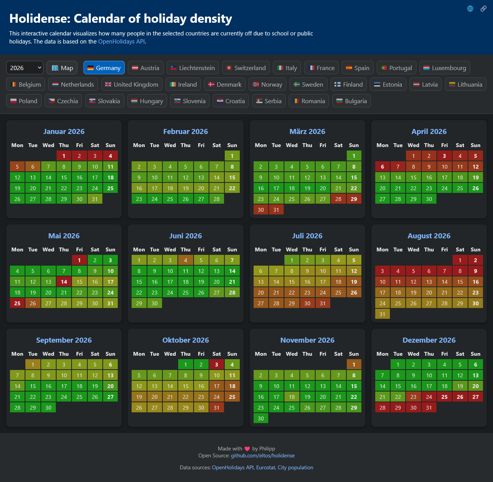

# 📅 Holidense: Holiday Density Calendar - Feriendichte Kalender
Interactive calendar to display public and school holiday density for central european countries.
Countries can be selected from the list or by distance using the interactive map.

Interaktiver Kalender, der für jeden Tag den Anteil der Bevölkerung angibt, der aufgrund von Schulferien oder Feiertagen in den ausgewählten Ländern gerade Urlaub hat.
Länder können über die Liste oder mit der interaktiven Karte nach Entfernung ausgewählt werden. 

The tool uses
holiday data from [OpenHolidays API](https://github.com/openpotato/openholidaysapi.data)
and population data from [Eurostat](https://doi.org/10.2908/DEMO_R_GIND3).

| https://eltos.github.io/holidense |
| --------------------------------- |

